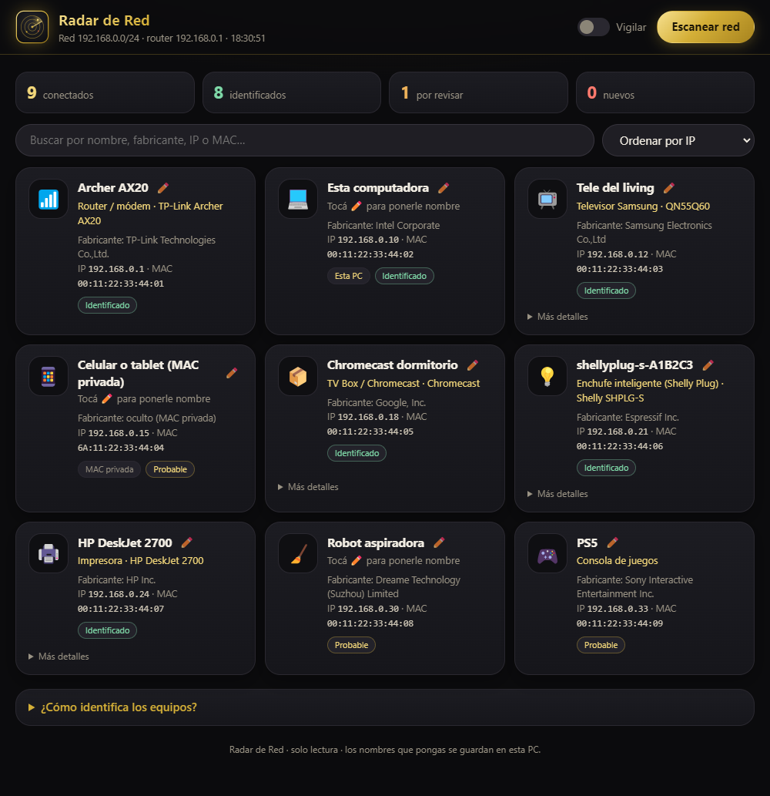

# Radar de Red 📡

App para **Windows** que descubre los equipos conectados a **tu red Wi-Fi** y te dice
**qué es cada uno**: televisores, celulares, TV Box, enchufes inteligentes, impresoras,
robots aspiradora, consolas y más.

<p align="center">
  <br>
  
</p>

> La captura usa **datos de ejemplo**.

## ✨ Qué hace

- **Encuentra todos los equipos** conectados a tu red local.
- **Identifica el fabricante** de cada uno por su dirección MAC (base de datos de más de 58.000 fabricantes).
- **Averigua el nombre y el modelo** preguntando con varios métodos estándar: el nombre que
  da el router, nombres de equipos Windows, servicios anunciados (Chromecast, AirPlay,
  impresoras, Spotify Connect…) y la ficha UPnP donde muchas teles y routers dicen su modelo exacto.
- **Te dice qué tipo de aparato es**, con ícono y nivel de seguridad (Identificado / Probable / Posible).
- **Ponéle nombre a cada equipo** ✏️ ("Tele del living", "Lavarropas") y lo recuerda aunque cambie de IP.
- **Modo Vigilar:** escanea cada 5 minutos y te avisa con una notificación de Windows si se conecta
  un equipo **nuevo**. Sirve para detectar intrusos en tu Wi-Fi.
- Lista de equipos **vistos antes pero desconectados ahora**.
- Buscador y orden por IP, tipo o nombre. Interfaz oscura con detalles en dorado.

## 🔒 Privacidad y seguridad

- **Solo lectura:** mira y pregunta, pero **no cambia nada** en el router ni en los equipos.
- Solo escanea **tu propia red local**. Usala únicamente en redes que sean tuyas o donde tengas permiso.
- Los nombres que pongas se guardan **solo en tu PC**. No se envía nada a internet.

## 📥 Instalar

Descargá `RadarDeRed-x.y.z.exe` desde **[Releases](../../releases)**. Es portable: doble clic y listo.
Si Windows muestra "protegió su PC", tocá **Más información → Ejecutar de todas formas**
(la app no tiene firma digital paga).

## ❓ Limitaciones

- Los **celulares modernos** usan una **MAC privada** (inventada por privacidad), así que no se
  sabe su marca: aparecen como "Celular o tablet (MAC privada)". Ponéles nombre con el lápiz
  o cambiá el nombre del dispositivo en el propio celular.
- Equipos **apagados o en reposo** pueden no contestar y quedar como "Posible" o "Desconocido".

## 🛠️ Compilar desde el código

```bash
npm install
npm start            # ejecutar
npm run dist         # genera dist/RadarDeRed-x.y.z.exe (portable)
```

- `src/scanner.js`: motor de escaneo (ARP, NetBIOS, mDNS, SSDP/UPnP, DNS inverso, OUI).
- `src/ui/`: interfaz.
- `data/oui.json`: base de fabricantes, generada a partir de la base pública `manuf` de
  [Wireshark](https://www.wireshark.org/).

## ⚖️ Licencia

[MIT](LICENSE). Software libre, úsalo bajo tu propio riesgo.
